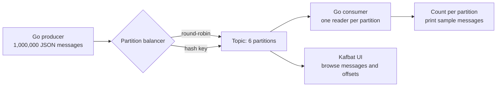

# Kafka producer/consumer demo

Ví dụ Go độc lập để gửi 1 triệu message, xem Kafka chia message vào partition nào, rồi đọc lại số lượng và một vài message mẫu. Topic mặc định là `demo-million-messages`, gồm 6 partition.

## Chạy demo

Mở broker Kafka local cùng Kafbat UI:

```sh
docker compose up -d
```

Gửi một triệu message:

```sh
go run . produce
```

Đọc lại message và in số lượng cùng hai message mẫu cho mỗi partition:

```sh
go run . consume
```

Mở [http://localhost:8080](http://localhost:8080), chọn cluster `local-demo` rồi topic `demo-million-messages` để duyệt partition, offset, key và value.

Để xem cách hash key thay đổi phân phối, dùng topic riêng:

```sh
go run . produce -strategy hash -topic demo-million-hash
go run . consume -topic demo-million-hash
```

Các cờ `-count`, `-partitions`, `-broker` và `-topic` có thể thay đổi. Producer và consumer cần dùng cùng topic, số partition và số message. Broker mặc định là `localhost:19092`; có thể ghi đè bằng `KAFKA_BROKERS`.

## Luồng message và partition



Producer gửi record có `key` và JSON `value`, ví dụ:

```json
{"id":0,"user_id":"user-000","text":"message-0000000"}
```

Producer chọn partition trước khi gửi message; broker ghi message vào partition được chỉ định. Với `round-robin`, producer Go lần lượt chọn partition, nên 1.000.000 message trên 6 partition sẽ cho 4 partition có 166.667 message và 2 partition có 166.666 message. Kafka giữ thứ tự theo offset trong từng partition, không có thứ tự tổng thể giữa các partition. Xem thêm tài liệu về [balancer của kafka-go](https://github.com/segmentio/kafka-go/blob/main/balancer.go) và [partition của Kafka](https://kafka.apache.org/protocol/).

Với `-strategy hash`, producer hash theo key `user_id`; các message cùng user sẽ vào cùng partition, còn số lượng giữa partition phụ thuộc cách các key được phân bố. Cách này giữ thứ tự theo key trong cùng partition. Kafka chỉ đảm bảo thứ tự bên trong từng partition, không có thứ tự tổng thể giữa các partition.

Ví dụ output của consumer:

```text
done: topic=demo-million-messages count=1000000 duration=...
partition=0 count=166667
  offset=0 key=user-000 value={"id":0,"user_id":"user-000","text":"message-0000000"}
  offset=1 key=user-006 value={"id":6,"user_id":"user-006","text":"message-0000006"}
...
```

## Công cụ theo dõi Kafka

| Công cụ | Dùng để làm gì | Phù hợp khi |
| --- | --- | --- |
| [Kafbat UI](https://github.com/kafbat/kafka-ui) | Xem broker, topic, partition, message, consumer group và lag trong giao diện web. Được tích hợp vào Compose ở trên. | Học Kafka, kiểm tra message và debug nhanh. |
| [Prometheus JMX Exporter](https://prometheus.github.io/jmx_exporter/) + [Grafana](https://grafana.com/docs/learning-paths/kafka-monitoring/understand-dashboards/) | Export metric từ JVM/broker để Prometheus thu thập; Grafana hiển thị throughput, tình trạng partition, broker và consumer lag theo thời gian. | Theo dõi vận hành lâu dài, dashboard và cảnh báo. Cần cấu hình JMX/exporter và Prometheus scrape; Compose demo chưa bật phần này. |
| [Kafdrop](https://github.com/obsidiandynamics/kafdrop) | Giao diện web gọn để duyệt topic, partition, message và consumer group. | Lựa chọn nhẹ khi chỉ cần xem dữ liệu Kafka. |

Đề xuất cho demo này: dùng Kafbat UI để nhìn partition và payload; khi cần lịch sử metric hoặc cảnh báo, bổ sung Prometheus JMX Exporter và Grafana. Kafbat UI hỗ trợ dashboard metric và consumer lag, còn Grafana phù hợp hơn để xây dashboard time-series và alerts từ bộ metric đã scrape.

Tắt broker và UI:

```sh
docker compose down
```

Compose không gắn volume cho Kafka, vì vậy tạo lại container sẽ tạo lại dữ liệu demo từ đầu.

## Khắc phục lỗi Kafbat UI không kết nối được Kafka

Nếu log có `No resolvable bootstrap urls given in bootstrap.servers`, kiểm tra cả hai service đang chạy:

```sh
docker compose ps
```

Trong Compose, Kafbat UI kết nối tới `kafka:9092` qua mạng Docker; chương trình Go chạy trên máy host thì dùng `localhost:19092`. Nếu UI chưa được nối vào mạng Compose, tạo lại riêng UI:

```sh
docker compose up -d --force-recreate kafbat-ui
```

Có thể kiểm tra UI đã sẵn sàng bằng cách mở `http://localhost:8080/actuator/health`; phản hồi mong đợi là `{"status":"UP"}`.
